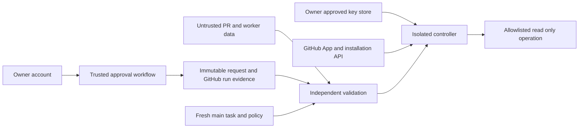

# Agent Identity v2 — модель угроз

Статус: проект, без реализации. Требования R01–R16 — в [ТЗ](README.md),
проверки A01–A32 — в [матрице](acceptance-matrix.md).

## Активы и доверенные предположения

Активы: owner consent и неизменяемые spec/evidence; App key/token; tasks/history;
код controller/policy; integrity main; пользовательские данные, signing/release
инфраструктура и воспроизводимый audit. Последние не должны быть доступны App.

Доверяем GitHub API/TLS и аутентификации owner account, проверенному main controller,
runner isolation и отдельно разрешённому key store. Это предположения, не результат
docs PR. Owner или repository admin с полным контролем может изменить корень доверия.
При подозрении на компрометацию этой границы прекращать выдачу полномочий.

Недоверенные источники: PR/fork code и JSON, inputs, комментарии/метки, artifacts,
worker outputs, bot name/commit author, посторонние Apps/installations, bearer token
из внешнего запроса, изменённое окружение untrusted job. Credentialed controller
не является sandbox для Python-кода, способного менять его globals/imports/environment.

## Поток доверия

Вся стрелка V→C — решение доверенного verifier, не принимаемый worker capability.
Внутри одного controller не нужен новый публичный сервер или доверие к bearer receipt
из PR. Если граница станет межсервисной, потребуется отдельно согласованный issuer,
аутентификация и replay protection; не изобретать их неявно при реализации.

## Реестр угроз

| ID | Угроза/предпосылка | Контроль | Проверки | Остаточный риск |
| --- | --- | --- | --- | --- |
| T01 | Поддельный bot login, App ID вместо user ID | Typed subject, pinned App/install/account/repo, независимый API | A02,A03,A04 | Компрометация controller/key store |
| T02 | Чужая installation того же App или reinstall | Pin installation/account IDs; новая привязка и consent | A04,A05,A23 | Owner ошибочно утвердил другую установку |
| T03 | Repository rename/transfer/похожее имя | Проверять numeric IDs и ожидаемый name/account, STOP на смене | A05 | Ошибка owner при повторной привязке |
| T04 | App согласует себя; PAT/user token владельца используется автоматом | Owner-only human subject; запрет user-token automation; отдельный approval verifier | A07,A08 | Компрометация owner account; API не доказывает физическое нажатие |
| T05 | Зеленый job/session_start/комментарий объявлен grant | Exact protocol/context hash и immutable request через GitHub API | A09,A10 | Удаление run снижает доступность, не безопасность |
| T06 | Подмена spec/operations/executor/policy после consent | Полный context binding, append-only, fresh main | A11,A12,A13 | Write-пользователь обходит CI на незащищённом main |
| T07 | Replay старого run/nonce, rerun, другая history position | Один request/transition, attempt1, проверка prefix/sequence | A10,A14 | Несколько действительных owner grants одного request требуют аудита, не автоматического выбора |
| T08 | Устаревший task после cancelled/blocked/revision change | Повторная полная проверка перед каждым действием | A15,A16 | In-flight действие не прерывается атомарно |
| T09 | TOCTOU и main ABA | Два SHA-чтения; stop на изменении, server-side защита отдельно | A17,A32 | ABA и изменение после последнего чтения не исключены |
| T10 | Поддельные GITHUB_* или run ID из worker | Server run metadata плюс approved workflow/source; run_id не authority | A18,A19 | Контроль доверенного процесса даёт контроль над локальными проверками |
| T11 | Выполнение PR code с ключом, dependency/cache poisoning | Отдельный job/workspace, pinned trusted code/actions, нет untrusted imports/cache/scripts | A20,A21 | Уязвимость runner/dependency; supply-chain review остаётся необходимым |
| T12 | Кража key/token через logs/artifacts/checkout/process | Изоляция, нет секретов у worker, минимальный lifecycle/revoke | A20,A22 | Нельзя отозвать уже прочитанные данные; holder token действует вне локального gate |
| T13 | Token выдан на все repos/с лишними правами | Explicit repo IDs/permissions; verify response/max grants; reject expansion | A06,A23 | App-key compromise позволяет mint до максимума installation permissions |
| T14 | Suspension, expired/revoked credentials продолжают использоваться | Свежая проверка, API401/403 deny, без cached-positive fallback | A24,A25 | Состояние может измениться после последней проверки |
| T15 | Ошибка API/pagination/rate limit превращена в allow | Fail closed по каждому чтению; retry только новой полной проверкой | A26 | Недоступность GitHub блокирует работу |
| T16 | V1 executor_id=123 переинтерпретирован как App | V1 history неизменна, новый v2 task и новое consent | A27 | Два протокола требуют явного version dispatch |
| T17 | Расширение test до произвольного shell/записи | Allowlist read_identity_smoke, read-only token, нет общего command input | A28,A29 | Ошибка trusted operation implementation |
| T18 | Contents:write использован для main/merge/release | Не выдавать в первом этапе; future write требует отдельной архитектуры | A29,A32 | Branch protection не ограничивает release API |
| T19 | Owner-only env approval заблокировано self-review restriction | Явное решение D02 для единственного человека; никакой фиктивной identity | A30 | Нет независимых двух human reviewers |
| T20 | Registry/policy изменены из PR, старый controller исполняет новую policy | Pin/digest registry/source, owner review key release, новый consent/run | A12,A19 | При unprotected main корень доверия зависит от owner и controller review |

## Отзыв, компрометация и потеря evidence

Реагировать по слоям: остановить следующие операции; запретить mint; revoke известный
token; приостановить installation при инциденте; owner rotation/delete старого ключа;
сохранить безопасный audit, переутвердить новую identity/policy. Удаление ключа не
считать автоматическим отзывом всех выданных tokens. Никаких destructive rollback
task/data или удаления history. Incident response — будущая отдельно разрешённая
операция владельца, не полномочие read-only App.

Долговечная копия логов полезна для расследования, но не заменяет независимую проверку
актуального GitHub evidence. Если run исчез — deny; expired/отозванный grant не
«оживает» из audit archive. Не хранить token/key или private event payload для аудита.

## Границы гарантий и вывод

Read-only профиль ограничивает возможный ущерб на GitHub API уровне: token не должен
позволять mutation repo. Это не защита от утечки доступных ему данных. Grant описывает
согласие владельца, а не делает bearer token непередаваемым и не доказывает корректность
произвольного кода/ИИ. Worker с token мог бы обходить локальный authorize, поэтому token
ему не выдаётся.

Main сейчас не защищён. Нельзя объявлять global enforcement против write/admin actor,
ни гарантию мгновенного отзыва/in-flight stop. Нужны owner review и минимизация creds
даже в read-only proof; write-переход заблокирован до отдельного security review,
required checks/защиты main и решения о broad contents/release полномочиях.
Ни один live security test этим документом не считается выполненным.
